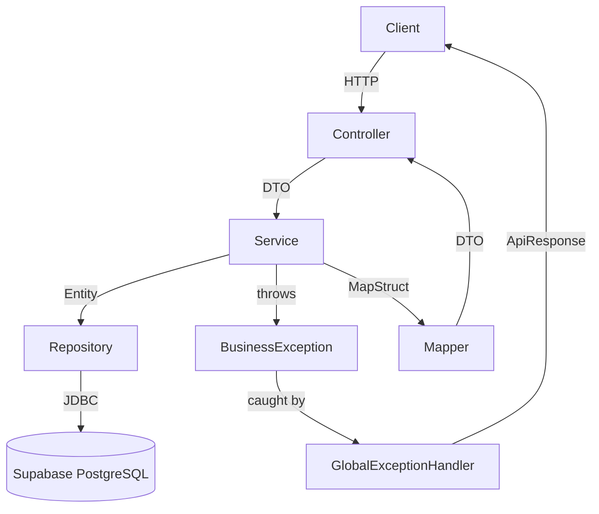
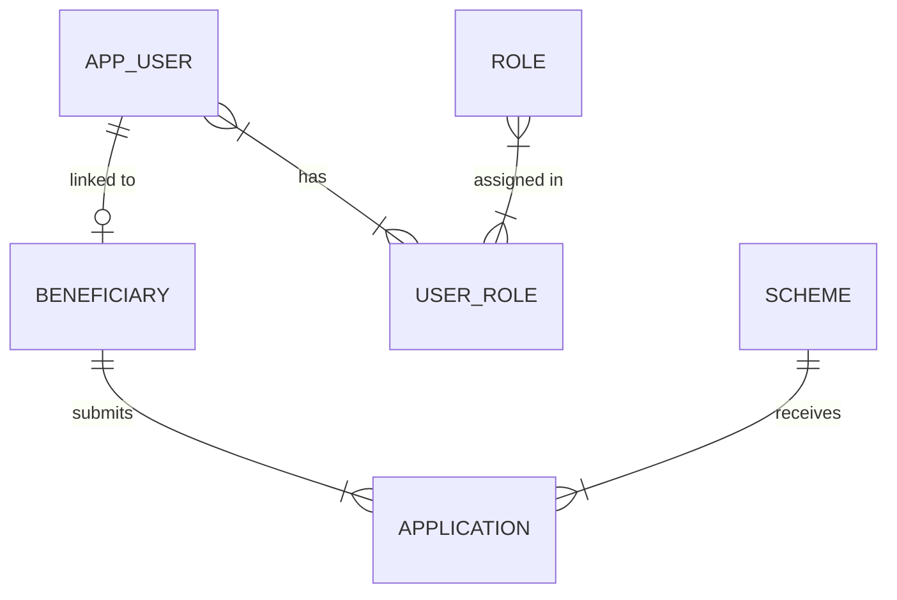

# Design Document: REST API Backend

## Overview

This document describes the technical design for the Scheme, Beneficiary, and Application API domains of the Government Subsidy & Grant Disbursement Tracking System. The User, Role, auth, and audit layers are already implemented and are referenced here but not redesigned.

The backend is a Spring Boot 4.1.2 application (Java 21) backed by a PostgreSQL database on Supabase. All six database tables (`app_user`, `role`, `user_role`, `scheme`, `beneficiary`, `application`) already exist with their JPA entity mappings. This feature adds the service, controller, DTO, mapper, and exception-handler layers needed to expose the remaining three domains through versioned REST APIs.

**Key design principles:**
- Domain-based package layout: each resource domain owns its `api`, `service`, and `mapper` sub-packages.
- DTOs are strictly separated from JPA entities; MapStruct mappers perform all conversions.
- All business rules are enforced in the service layer; controllers remain thin.
- `GlobalExceptionHandler` already exists and handles all exception-to-HTTP mapping; it is extended for new error codes but its structure is not changed.
- All monetary fields use `BigDecimal`; all UUID identifiers use `UUID`; all BIGINT identifiers use `Long`; all date fields use `LocalDate`.
- Constructor injection is used throughout; `@Autowired` and field injection are prohibited.
- Hibernate `ddl-auto=validate` protects the existing schema from accidental changes.
- Credentials are read exclusively from environment variables.

---

## Architecture



The three new domains follow identical layering:

```
com.govgrants.subsidygrant
├── scheme
│   ├── api               ← Controller, Request/Response DTOs
│   ├── service           ← SchemeService
│   └── mapper            ← SchemeMapper (MapStruct)
├── beneficiary
│   ├── api               ← Controller, Request/Response DTOs
│   ├── service           ← BeneficiaryService
│   └── mapper            ← BeneficiaryMapper (MapStruct)
├── application
│   ├── api               ← Controller, Request/Response DTOs
│   ├── service           ← ApplicationService, ApplicationStatusTransitionValidator
│   └── mapper            ← ApplicationMapper (MapStruct)
└── common
    ├── api               ← GlobalExceptionHandler (already exists, extended)
    ├── exception         ← All exception classes (already exist)
    ├── response          ← ApiResponse<T>, PagedResponse<T> (already exist)
    └── filter            ← CorrelationIdFilter (already exists)
```

Existing packages (`auth`, `user`, `audit`, `entity`, `repository`, `enums`) are **not modified**. The new domain packages import from them.

---

## Components and Interfaces

### 2.1 Scheme Domain

#### Package: `com.govgrants.subsidygrant.scheme.api`

**`CreateSchemeRequest`** — already exists at `dto.request.CreateSchemeRequest`. Move to `scheme.api` package. Fields and annotations are already correct (see existing file). No changes needed to field definitions; the class is relocated to align with the domain-based layout.

> **Implementation note:** `CreateSchemeRequest` currently lives at `com.govgrants.subsidygrant.dto.request`. Relocate to `com.govgrants.subsidygrant.scheme.api` and update imports accordingly.

```java
// com.govgrants.subsidygrant.scheme.api.CreateSchemeRequest
@Getter @Setter @NoArgsConstructor @AllArgsConstructor @Builder
public class CreateSchemeRequest {
    @NotBlank(message = "Scheme name is required")
    @Size(max = 200)
    private String name;

    @NotBlank(message = "Scheme code is required")
    @Size(max = 50)
    private String code;

    private String description;

    @NotNull(message = "Start date is required")
    private LocalDate startDate;

    @NotNull(message = "End date is required")
    private LocalDate endDate;

    @NotNull(message = "Minimum grant amount is required")
    @DecimalMin(value = "0.01", message = "Minimum grant amount must be greater than zero")
    private BigDecimal minGrantAmount;

    @NotNull(message = "Maximum grant amount is required")
    @DecimalMin(value = "0.01", message = "Maximum grant amount must be greater than zero")
    private BigDecimal maxGrantAmount;

    // Optional; defaults to DRAFT in service layer if null
    private SchemeStatus status;
}
```

**`UpdateSchemeRequest`**

```java
// com.govgrants.subsidygrant.scheme.api.UpdateSchemeRequest
@Getter @Setter @NoArgsConstructor @AllArgsConstructor @Builder
public class UpdateSchemeRequest {
    @NotBlank(message = "Scheme name is required")
    @Size(max = 200)
    private String name;

    private String description;

    @NotNull(message = "Start date is required")
    private LocalDate startDate;

    @NotNull(message = "End date is required")
    private LocalDate endDate;

    @NotNull(message = "Minimum grant amount is required")
    @DecimalMin(value = "0.01")
    private BigDecimal minGrantAmount;

    @NotNull(message = "Maximum grant amount is required")
    @DecimalMin(value = "0.01")
    private BigDecimal maxGrantAmount;
}
```

**`SchemeStatusRequest`**

```java
// com.govgrants.subsidygrant.scheme.api.SchemeStatusRequest
@Getter @Setter @NoArgsConstructor @AllArgsConstructor
public class SchemeStatusRequest {
    @NotNull(message = "Status is required")
    private SchemeStatus status;
}
```

**`SchemeResponse`**

```java
// com.govgrants.subsidygrant.scheme.api.SchemeResponse
@Getter @Setter @NoArgsConstructor @AllArgsConstructor @Builder
public class SchemeResponse {
    private UUID id;
    private String name;
    private String code;
    private String description;
    private LocalDate startDate;
    private LocalDate endDate;
    private BigDecimal minGrantAmount;
    private BigDecimal maxGrantAmount;
    private SchemeStatus status;
    private Instant createdAt;
    private Instant updatedAt;
}
```

**`SchemeSummaryResponse`** (for paginated list)

```java
// com.govgrants.subsidygrant.scheme.api.SchemeSummaryResponse
@Getter @Setter @NoArgsConstructor @AllArgsConstructor @Builder
public class SchemeSummaryResponse {
    private UUID id;
    private String name;
    private String code;
    private SchemeStatus status;
    private LocalDate startDate;
    private LocalDate endDate;
    private BigDecimal minGrantAmount;
    private BigDecimal maxGrantAmount;
}
```

**`SchemeController`**

```java
// com.govgrants.subsidygrant.scheme.api.SchemeController
@RestController
@RequestMapping("/api/v1/schemes")
@Tag(name = "Schemes", description = "Government subsidy and grant scheme management")
public class SchemeController {

    private final SchemeService schemeService;

    public SchemeController(SchemeService schemeService) {
        this.schemeService = schemeService;
    }

    @PostMapping
    @ResponseStatus(HttpStatus.CREATED)
    @Operation(summary = "Create a scheme", responses = {
        @io.swagger.v3.oas.annotations.responses.ApiResponse(responseCode = "201"),
        @io.swagger.v3.oas.annotations.responses.ApiResponse(responseCode = "400"),
        @io.swagger.v3.oas.annotations.responses.ApiResponse(responseCode = "409")
    })
    public ResponseEntity<ApiResponse<SchemeResponse>> create(
            @Valid @RequestBody CreateSchemeRequest request);

    @GetMapping
    @Operation(summary = "List schemes (paginated)")
    public ApiResponse<PagedResponse<SchemeSummaryResponse>> list(
            @RequestParam(defaultValue = "0") int page,
            @RequestParam(defaultValue = "10") int size,
            @RequestParam(required = false) String sort);

    @GetMapping("/{id}")
    @Operation(summary = "Get scheme by ID")
    public ApiResponse<SchemeResponse> getById(@PathVariable UUID id);

    @GetMapping("/code/{code}")
    @Operation(summary = "Get scheme by code")
    public ApiResponse<SchemeResponse> getByCode(@PathVariable String code);

    @PutMapping("/{id}")
    @Operation(summary = "Update scheme")
    public ApiResponse<SchemeResponse> update(
            @PathVariable UUID id,
            @Valid @RequestBody UpdateSchemeRequest request);

    @PatchMapping("/{id}/status")
    @Operation(summary = "Change scheme status")
    public ApiResponse<SchemeResponse> updateStatus(
            @PathVariable UUID id,
            @Valid @RequestBody SchemeStatusRequest request);

    @DeleteMapping("/{id}")
    @ResponseStatus(HttpStatus.NO_CONTENT)
    @Operation(summary = "Delete scheme")
    public ResponseEntity<Void> delete(@PathVariable UUID id);
}
```

---

#### Package: `com.govgrants.subsidygrant.scheme.service`

**`SchemeService`**

```java
// com.govgrants.subsidygrant.scheme.service.SchemeService
@Service
@Transactional
public class SchemeService {

    private final SchemeRepository schemeRepository;
    private final ApplicationRepository applicationRepository;
    private final SchemeMapper schemeMapper;

    public SchemeService(SchemeRepository schemeRepository,
                         ApplicationRepository applicationRepository,
                         SchemeMapper schemeMapper) { ... }

    // REQ-10.1–10.9: Validates no duplicate code, start <= end, max >= min > 0.
    // Sets status = DRAFT if request.status is null.
    public SchemeResponse createScheme(CreateSchemeRequest request);

    // REQ-11: Returns paginated list sorted by name asc by default.
    @Transactional(readOnly = true)
    public Page<SchemeSummaryResponse> listSchemes(Pageable pageable);

    // REQ-11.2–11.3
    @Transactional(readOnly = true)
    public SchemeResponse getById(UUID id);

    // REQ-11.4–11.5
    @Transactional(readOnly = true)
    public SchemeResponse getByCode(String code);

    // REQ-12: Validates date range, amount range. Code is immutable.
    public SchemeResponse updateScheme(UUID id, UpdateSchemeRequest request);

    // REQ-13: Accepts any valid SchemeStatus value.
    public SchemeResponse updateStatus(UUID id, SchemeStatus status);

    // REQ-14: Checks applicationRepository.existsBySchemeId(id) before delete.
    // Throws ResourceInUseException if applications exist.
    public void deleteScheme(UUID id);
}
```

**Business rules enforced by `SchemeService`:**

| Rule | Exception thrown |
|------|-----------------|
| Duplicate scheme code on create | `DuplicateResourceException("Scheme code already exists: {code}")` |
| `startDate` after `endDate` | `BusinessRuleException("INVALID_DATE_RANGE", "Start date must not be after end date")` |
| `maxGrantAmount` < `minGrantAmount` | `BusinessRuleException("INVALID_AMOUNT_RANGE", "Maximum grant amount must be >= minimum grant amount")` |
| Scheme not found by ID | `ResourceNotFoundException("Scheme not found: {id}")` |
| Scheme not found by code | `ResourceNotFoundException("Scheme not found with code: {code}")` |
| Delete with existing applications | `ResourceInUseException("Scheme has associated applications and cannot be deleted")` |

---

#### Package: `com.govgrants.subsidygrant.scheme.mapper`

```java
// com.govgrants.subsidygrant.scheme.mapper.SchemeMapper
@Mapper(componentModel = "spring")
public interface SchemeMapper {
    SchemeResponse toResponse(Scheme scheme);
    SchemeSummaryResponse toSummaryResponse(Scheme scheme);
    // create/update: mapping done manually in service to handle business-rule defaults
}
```

---

### 2.2 Beneficiary Domain

#### Package: `com.govgrants.subsidygrant.beneficiary.api`

**`CreateBeneficiaryRequest`**

```java
// com.govgrants.subsidygrant.beneficiary.api.CreateBeneficiaryRequest
@Getter @Setter @NoArgsConstructor @AllArgsConstructor @Builder
public class CreateBeneficiaryRequest {
    @NotNull(message = "Beneficiary type is required")
    private BeneficiaryType beneficiaryType;

    @NotBlank(message = "Full name is required")
    @Size(max = 150)
    private String fullName;

    @NotBlank(message = "Identity reference is required")
    @Size(max = 100)
    private String identityReference;

    @Email(message = "Email must be a valid email address")
    @Size(max = 255)
    private String email;

    @Size(max = 20)
    private String phone;

    private String address;

    @Size(max = 30)
    private String regionCode;

    // Optional: links this beneficiary to an existing AppUser
    private UUID userId;
}
```

**`UpdateBeneficiaryRequest`**

```java
// com.govgrants.subsidygrant.beneficiary.api.UpdateBeneficiaryRequest
@Getter @Setter @NoArgsConstructor @AllArgsConstructor @Builder
public class UpdateBeneficiaryRequest {
    @NotBlank(message = "Full name is required")
    @Size(max = 150)
    private String fullName;

    @Size(max = 100)
    private String identityReference;

    @Email
    @Size(max = 255)
    private String email;

    @Size(max = 20)
    private String phone;

    private String address;

    @Size(max = 30)
    private String regionCode;
}
```

**`BeneficiaryResponse`**

```java
// com.govgrants.subsidygrant.beneficiary.api.BeneficiaryResponse
@Getter @Setter @NoArgsConstructor @AllArgsConstructor @Builder
public class BeneficiaryResponse {
    private UUID id;
    private UUID userId;        // nullable — the linked AppUser id
    private BeneficiaryType beneficiaryType;
    private String fullName;
    private String identityReference;
    private String email;
    private String phone;
    private String address;
    private String regionCode;
    private Instant createdAt;
    private Instant updatedAt;
}
```

**`BeneficiarySummaryResponse`** (for paginated lists)

```java
// com.govgrants.subsidygrant.beneficiary.api.BeneficiarySummaryResponse
@Getter @Setter @NoArgsConstructor @AllArgsConstructor @Builder
public class BeneficiarySummaryResponse {
    private UUID id;
    private BeneficiaryType beneficiaryType;
    private String fullName;
    private String identityReference;
    private String regionCode;
}
```

**`BeneficiaryController`**

```java
// com.govgrants.subsidygrant.beneficiary.api.BeneficiaryController
@RestController
@RequestMapping("/api/v1/beneficiaries")
@Tag(name = "Beneficiaries", description = "Beneficiary profile management")
public class BeneficiaryController {

    private final BeneficiaryService beneficiaryService;

    public BeneficiaryController(BeneficiaryService beneficiaryService) { ... }

    @PostMapping                          // → 201
    public ResponseEntity<ApiResponse<BeneficiaryResponse>> create(
            @Valid @RequestBody CreateBeneficiaryRequest request);

    @GetMapping                           // → 200 paged
    public ApiResponse<PagedResponse<BeneficiarySummaryResponse>> list(
            @RequestParam(defaultValue = "0") int page,
            @RequestParam(defaultValue = "10") int size);

    @GetMapping("/{id}")                  // → 200
    public ApiResponse<BeneficiaryResponse> getById(@PathVariable UUID id);

    @GetMapping("/region/{regionCode}")   // → 200 paged
    public ApiResponse<PagedResponse<BeneficiarySummaryResponse>> listByRegion(
            @PathVariable String regionCode,
            @RequestParam(defaultValue = "0") int page,
            @RequestParam(defaultValue = "10") int size);

    @GetMapping("/type/{type}")           // → 200 paged
    public ApiResponse<PagedResponse<BeneficiarySummaryResponse>> listByType(
            @PathVariable BeneficiaryType type,
            @RequestParam(defaultValue = "0") int page,
            @RequestParam(defaultValue = "10") int size);

    @PutMapping("/{id}")                  // → 200
    public ApiResponse<BeneficiaryResponse> update(
            @PathVariable UUID id,
            @Valid @RequestBody UpdateBeneficiaryRequest request);

    @DeleteMapping("/{id}")               // → 204
    public ResponseEntity<Void> delete(@PathVariable UUID id);
}
```

---

#### Package: `com.govgrants.subsidygrant.beneficiary.service`

**`BeneficiaryService`**

```java
// com.govgrants.subsidygrant.beneficiary.service.BeneficiaryService
@Service
@Transactional
public class BeneficiaryService {

    private final BeneficiaryRepository beneficiaryRepository;
    private final AppUserRepository appUserRepository;
    private final BeneficiaryMapper beneficiaryMapper;

    public BeneficiaryService(BeneficiaryRepository beneficiaryRepository,
                               AppUserRepository appUserRepository,
                               BeneficiaryMapper beneficiaryMapper) { ... }

    // REQ-15.1–15.7
    public BeneficiaryResponse registerBeneficiary(CreateBeneficiaryRequest request);

    // REQ-16.1
    @Transactional(readOnly = true)
    public Page<BeneficiarySummaryResponse> listBeneficiaries(Pageable pageable);

    // REQ-16.2–16.3
    @Transactional(readOnly = true)
    public BeneficiaryResponse getById(UUID id);

    // REQ-16.4
    @Transactional(readOnly = true)
    public Page<BeneficiarySummaryResponse> listByRegion(String regionCode, Pageable pageable);

    // REQ-16.5
    @Transactional(readOnly = true)
    public Page<BeneficiarySummaryResponse> listByType(BeneficiaryType type, Pageable pageable);

    // REQ-17.1–17.3
    public BeneficiaryResponse updateBeneficiary(UUID id, UpdateBeneficiaryRequest request);

    // REQ-18.1–18.2
    public void deleteBeneficiary(UUID id);
}
```

**Business rules enforced by `BeneficiaryService`:**

| Rule | Exception thrown |
|------|-----------------|
| Blank full name | Caught by Bean Validation (`@NotBlank`) |
| Invalid `BeneficiaryType` | Caught by Bean Validation / Jackson deserialization → `HttpMessageNotReadableException` |
| Duplicate `identityReference` on create | `DuplicateResourceException("Identity reference already registered: {ref}")` |
| `userId` already linked to another beneficiary | `DuplicateResourceException("User is already linked to another beneficiary")` |
| Beneficiary not found | `ResourceNotFoundException("Beneficiary not found: {id}")` |
| Duplicate `identityReference` on update (different record) | `DuplicateResourceException("Identity reference already belongs to another beneficiary")` |

---

#### Package: `com.govgrants.subsidygrant.beneficiary.mapper`

```java
// com.govgrants.subsidygrant.beneficiary.mapper.BeneficiaryMapper
@Mapper(componentModel = "spring")
public interface BeneficiaryMapper {
    @Mapping(target = "userId", source = "user.id")
    BeneficiaryResponse toResponse(Beneficiary beneficiary);

    @Mapping(target = "userId", source = "user.id")
    BeneficiarySummaryResponse toSummaryResponse(Beneficiary beneficiary);
}
```

---

### 2.3 Application Domain

#### Package: `com.govgrants.subsidygrant.application.api`

**`CreateApplicationRequest`**

```java
// com.govgrants.subsidygrant.application.api.CreateApplicationRequest
@Getter @Setter @NoArgsConstructor @AllArgsConstructor @Builder
public class CreateApplicationRequest {
    @NotNull(message = "Beneficiary ID is required")
    private UUID beneficiaryId;

    @NotNull(message = "Scheme ID is required")
    private UUID schemeId;

    @NotBlank(message = "Reference number is required")
    @Size(max = 40)
    private String referenceNo;

    @NotNull(message = "Requested amount is required")
    @DecimalMin(value = "0.01", message = "Requested amount must be greater than zero")
    private BigDecimal requestedAmount;

    // Optional; defaults to DRAFT if null
    private ApplicationStatus status;
}
```

**`UpdateApplicationRequest`**

```java
// com.govgrants.subsidygrant.application.api.UpdateApplicationRequest
@Getter @Setter @NoArgsConstructor @AllArgsConstructor @Builder
public class UpdateApplicationRequest {
    @NotNull(message = "Requested amount is required")
    @DecimalMin(value = "0.01")
    private BigDecimal requestedAmount;
}
```

**`ApplicationStatusRequest`**

```java
// com.govgrants.subsidygrant.application.api.ApplicationStatusRequest
@Getter @Setter @NoArgsConstructor @AllArgsConstructor
public class ApplicationStatusRequest {
    @NotNull(message = "Status is required")
    private ApplicationStatus status;
}
```

**`ApplicationResponse`**

```java
// com.govgrants.subsidygrant.application.api.ApplicationResponse
@Getter @Setter @NoArgsConstructor @AllArgsConstructor @Builder
public class ApplicationResponse {
    private UUID id;
    private String referenceNo;
    private UUID beneficiaryId;
    private String beneficiaryFullName;
    private UUID schemeId;
    private String schemeName;
    private String schemeCode;
    private BigDecimal requestedAmount;
    private ApplicationStatus status;
    private Instant submittedAt;
    private Instant createdAt;
    private Instant updatedAt;
}
```

**`ApplicationSummaryResponse`** (for paginated lists)

```java
// com.govgrants.subsidygrant.application.api.ApplicationSummaryResponse
@Getter @Setter @NoArgsConstructor @AllArgsConstructor @Builder
public class ApplicationSummaryResponse {
    private UUID id;
    private String referenceNo;
    private UUID beneficiaryId;
    private String beneficiaryFullName;
    private UUID schemeId;
    private String schemeCode;
    private BigDecimal requestedAmount;
    private ApplicationStatus status;
    private Instant createdAt;
}
```

**`ApplicationController`**

```java
// com.govgrants.subsidygrant.application.api.ApplicationController
@RestController
@RequestMapping("/api/v1/applications")
@Tag(name = "Applications", description = "Grant application management")
public class ApplicationController {

    private final ApplicationService applicationService;

    public ApplicationController(ApplicationService applicationService) { ... }

    @PostMapping                                    // → 201
    public ResponseEntity<ApiResponse<ApplicationResponse>> create(
            @Valid @RequestBody CreateApplicationRequest request);

    @GetMapping                                     // → 200 paged
    public ApiResponse<PagedResponse<ApplicationSummaryResponse>> list(
            @RequestParam(defaultValue = "0") int page,
            @RequestParam(defaultValue = "10") int size);

    @GetMapping("/{id}")                            // → 200
    public ApiResponse<ApplicationResponse> getById(@PathVariable UUID id);

    @GetMapping("/reference/{referenceNo}")         // → 200
    public ApiResponse<ApplicationResponse> getByReferenceNo(
            @PathVariable String referenceNo);

    @GetMapping("/beneficiary/{beneficiaryId}")     // → 200 paged
    public ApiResponse<PagedResponse<ApplicationSummaryResponse>> listByBeneficiary(
            @PathVariable UUID beneficiaryId,
            @RequestParam(defaultValue = "0") int page,
            @RequestParam(defaultValue = "10") int size);

    @GetMapping("/scheme/{schemeId}")               // → 200 paged
    public ApiResponse<PagedResponse<ApplicationSummaryResponse>> listByScheme(
            @PathVariable UUID schemeId,
            @RequestParam(defaultValue = "0") int page,
            @RequestParam(defaultValue = "10") int size);

    @PutMapping("/{id}")                            // → 200
    public ApiResponse<ApplicationResponse> update(
            @PathVariable UUID id,
            @Valid @RequestBody UpdateApplicationRequest request);

    @PatchMapping("/{id}/status")                   // → 200
    public ApiResponse<ApplicationResponse> updateStatus(
            @PathVariable UUID id,
            @Valid @RequestBody ApplicationStatusRequest request);

    @DeleteMapping("/{id}")                         // → 204
    public ResponseEntity<Void> delete(@PathVariable UUID id);
}
```

---

#### Package: `com.govgrants.subsidygrant.application.service`

**`ApplicationStatusTransitionValidator`**

```java
// com.govgrants.subsidygrant.application.service.ApplicationStatusTransitionValidator
@Component
public class ApplicationStatusTransitionValidator {

    // REQ-22.3: single source of truth for all allowed transitions
    private static final Map<ApplicationStatus, Set<ApplicationStatus>> ALLOWED_TRANSITIONS =
        Map.ofEntries(
            Map.entry(ApplicationStatus.DRAFT,
                Set.of(ApplicationStatus.SUBMITTED)),
            Map.entry(ApplicationStatus.SUBMITTED,
                Set.of(ApplicationStatus.UNDER_REVIEW, ApplicationStatus.ON_HOLD,
                       ApplicationStatus.REJECTED)),
            Map.entry(ApplicationStatus.UNDER_REVIEW,
                Set.of(ApplicationStatus.CLARIFICATION_REQUIRED, ApplicationStatus.FIELD_VERIFIED,
                       ApplicationStatus.ON_HOLD, ApplicationStatus.REJECTED)),
            Map.entry(ApplicationStatus.CLARIFICATION_REQUIRED,
                Set.of(ApplicationStatus.UNDER_REVIEW, ApplicationStatus.REJECTED)),
            Map.entry(ApplicationStatus.FIELD_VERIFIED,
                Set.of(ApplicationStatus.DISTRICT_APPROVED, ApplicationStatus.REJECTED)),
            Map.entry(ApplicationStatus.DISTRICT_APPROVED,
                Set.of(ApplicationStatus.FINANCE_APPROVED, ApplicationStatus.REJECTED)),
            Map.entry(ApplicationStatus.FINANCE_APPROVED,
                Set.of(ApplicationStatus.DISBURSEMENT_IN_PROGRESS, ApplicationStatus.REJECTED)),
            Map.entry(ApplicationStatus.DISBURSEMENT_IN_PROGRESS,
                Set.of(ApplicationStatus.COMPLETED)),
            Map.entry(ApplicationStatus.ON_HOLD,
                Set.of(ApplicationStatus.UNDER_REVIEW, ApplicationStatus.REJECTED)),
            Map.entry(ApplicationStatus.COMPLETED, Set.of()),
            Map.entry(ApplicationStatus.REJECTED, Set.of())
        );

    /**
     * Validates that moving from {@code current} to {@code next} is an allowed transition.
     * Throws {@link BusinessRuleException} with error code INVALID_STATUS_TRANSITION if not.
     *
     * @param current the current ApplicationStatus
     * @param next    the requested target ApplicationStatus
     */
    public void validate(ApplicationStatus current, ApplicationStatus next);

    /**
     * Returns the set of valid next statuses from the given current status.
     * Used by tests and documentation generators.
     */
    public Set<ApplicationStatus> getAllowedTransitions(ApplicationStatus current);
}
```

**`ApplicationService`**

```java
// com.govgrants.subsidygrant.application.service.ApplicationService
@Service
@Transactional
public class ApplicationService {

    private final ApplicationRepository applicationRepository;
    private final BeneficiaryRepository beneficiaryRepository;
    private final SchemeRepository schemeRepository;
    private final ApplicationStatusTransitionValidator transitionValidator;
    private final ApplicationMapper applicationMapper;

    public ApplicationService(ApplicationRepository applicationRepository,
                               BeneficiaryRepository beneficiaryRepository,
                               SchemeRepository schemeRepository,
                               ApplicationStatusTransitionValidator transitionValidator,
                               ApplicationMapper applicationMapper) { ... }

    // REQ-19.1–19.9
    public ApplicationResponse createApplication(CreateApplicationRequest request);

    // REQ-20.1
    @Transactional(readOnly = true)
    public Page<ApplicationSummaryResponse> listApplications(Pageable pageable);

    // REQ-20.2–20.3
    @Transactional(readOnly = true)
    public ApplicationResponse getById(UUID id);

    // REQ-20.4–20.5
    @Transactional(readOnly = true)
    public ApplicationResponse getByReferenceNo(String referenceNo);

    // REQ-20.6
    @Transactional(readOnly = true)
    public Page<ApplicationSummaryResponse> listByBeneficiary(UUID beneficiaryId, Pageable pageable);

    // REQ-20.7
    @Transactional(readOnly = true)
    public Page<ApplicationSummaryResponse> listByScheme(UUID schemeId, Pageable pageable);

    // REQ-21.1–21.3: validates amount still within scheme range after update
    public ApplicationResponse updateApplication(UUID id, UpdateApplicationRequest request);

    // REQ-22.1–22.5: delegates transition check to ApplicationStatusTransitionValidator
    public ApplicationResponse updateStatus(UUID id, ApplicationStatus targetStatus);

    // No explicit delete rule in requirements; returns 204 on success
    public void deleteApplication(UUID id);
}
```

**Business rules enforced by `ApplicationService`:**

| Rule | Exception thrown |
|------|-----------------|
| Beneficiary not found | `ResourceNotFoundException("Beneficiary not found: {id}")` |
| Scheme not found | `ResourceNotFoundException("Scheme not found: {id}")` |
| Scheme status is not OPEN | `BusinessRuleException("SCHEME_NOT_OPEN", "Applications can only be submitted for OPEN schemes")` |
| `requestedAmount` < `scheme.minGrantAmount` or > `scheme.maxGrantAmount` | `BusinessRuleException("AMOUNT_OUT_OF_RANGE", "Requested amount {x} is outside scheme range [{min}, {max}]")` |
| `requestedAmount` <= 0 | Caught by Bean Validation (`@DecimalMin("0.01")`) |
| Duplicate `referenceNo` | `DuplicateResourceException("Reference number already exists: {ref}")` |
| Application not found | `ResourceNotFoundException("Application not found: {id}")` |
| Invalid status transition | `BusinessRuleException("INVALID_STATUS_TRANSITION", "Transition from {current} to {next} is not allowed")` |
| Update amount outside scheme range | `BusinessRuleException("AMOUNT_OUT_OF_RANGE", "Requested amount is outside scheme range")` |

---

#### Package: `com.govgrants.subsidygrant.application.mapper`

```java
// com.govgrants.subsidygrant.application.mapper.ApplicationMapper
@Mapper(componentModel = "spring")
public interface ApplicationMapper {
    @Mapping(target = "beneficiaryId", source = "beneficiary.id")
    @Mapping(target = "beneficiaryFullName", source = "beneficiary.fullName")
    @Mapping(target = "schemeId", source = "scheme.id")
    @Mapping(target = "schemeName", source = "scheme.name")
    @Mapping(target = "schemeCode", source = "scheme.code")
    ApplicationResponse toResponse(Application application);

    @Mapping(target = "beneficiaryId", source = "beneficiary.id")
    @Mapping(target = "beneficiaryFullName", source = "beneficiary.fullName")
    @Mapping(target = "schemeId", source = "scheme.id")
    @Mapping(target = "schemeCode", source = "scheme.code")
    ApplicationSummaryResponse toSummaryResponse(Application application);
}
```

---

## Data Models

### Entity Relationships (read-only reference)



### DTO → Entity Field Mapping

| DTO Field | Entity Field | Notes |
|-----------|-------------|-------|
| `CreateSchemeRequest.code` | `Scheme.code` | Unique; immutable after create |
| `CreateSchemeRequest.status` | `Scheme.status` | Defaults to `DRAFT` if null |
| `CreateBeneficiaryRequest.userId` | `Beneficiary.user.id` | Optional FK to `AppUser` |
| `CreateApplicationRequest.referenceNo` | `Application.referenceNo` | Unique; caller-supplied |
| `CreateApplicationRequest.status` | `Application.status` | Defaults to `DRAFT` if null |
| `ApplicationResponse.beneficiaryId` | `Application.beneficiary.id` | Flattened by mapper |
| `ApplicationResponse.schemeId` | `Application.scheme.id` | Flattened by mapper |

---

## Correctness Properties

*A property is a characteristic or behavior that should hold true across all valid executions of a system — essentially, a formal statement about what the system should do. Properties serve as the bridge between human-readable specifications and machine-verifiable correctness guarantees.*

### Property 1: Amount range invariant

*For any* persisted Application, the `requestedAmount` must be greater than zero and fall within the interval `[scheme.minGrantAmount, scheme.maxGrantAmount]` of the linked Scheme.

**Validates: Requirements 19.5, 19.6, 21.3**

---

### Property 2: Status transition safety

*For any* Application, every status change must follow a valid edge in the transition graph defined in `ApplicationStatusTransitionValidator.ALLOWED_TRANSITIONS`. No transition from a terminal state (`COMPLETED`, `REJECTED`) is ever accepted.

**Validates: Requirements 22.1, 22.2, 22.3**

---

### Property 3: Beneficiary identity reference uniqueness

*For any* two distinct Beneficiary records in the system, their `identityReference` values must differ.

**Validates: Requirements 15.4, 17.3**

---

### Property 4: Scheme code uniqueness

*For any* two distinct Scheme records in the system, their `code` values must differ.

**Validates: Requirements 10.3**

---

### Property 5: Application reference number uniqueness

*For any* two distinct Application records in the system, their `referenceNo` values must differ.

**Validates: Requirements 19.7**

---

### Property 6: Scheme amount ordering invariant

*For any* persisted Scheme, `minGrantAmount` must be greater than zero and `maxGrantAmount` must be greater than or equal to `minGrantAmount`.

**Validates: Requirements 10.5, 10.6, 10.7, 12.3**

---

### Property 7: Scheme is OPEN for application creation

*For any* CreateApplicationRequest, if the targeted Scheme has a status other than `OPEN`, the creation must be rejected regardless of all other fields.

**Validates: Requirements 19.4**

---

## Error Handling

### GlobalExceptionHandler (already implemented)

The `GlobalExceptionHandler` at `com.govgrants.subsidygrant.common.api.GlobalExceptionHandler` is already fully implemented and handles all required exception types. The new service classes must throw the existing exception types listed below; no new exception classes need to be created.

| Exception | HTTP Status | Error Code |
|-----------|------------|------------|
| `ResourceNotFoundException` | 404 | `RESOURCE_NOT_FOUND` |
| `DuplicateResourceException` | 409 | `DUPLICATE_RESOURCE` |
| `ResourceInUseException` | 409 | `RESOURCE_IN_USE` |
| `BusinessRuleException` | 422 | caller-supplied code (e.g. `SCHEME_NOT_OPEN`, `AMOUNT_OUT_OF_RANGE`, `INVALID_STATUS_TRANSITION`, `INVALID_DATE_RANGE`, `INVALID_AMOUNT_RANGE`) |
| `MethodArgumentNotValidException` | 400 | `VALIDATION_FAILED` with field-level errors |
| `HttpMessageNotReadableException` | 400 | `MALFORMED_JSON` |
| `MethodArgumentTypeMismatchException` | 400 | `INVALID_PARAMETER` |
| `DataIntegrityViolationException` | 409 | `DUPLICATE_RESOURCE` |
| `Exception` (fallback) | 500 | `INTERNAL_ERROR` |

**No internal detail** (stack traces, SQL, entity state) is ever included in a response body. The fallback handler logs the full exception server-side with the correlation ID from MDC.

### Response Envelope

All responses use `ApiResponse<T>`:
- Success: `{ success: true, message: "...", data: {...}, timestamp: "..." }`
- Error: `{ success: false, message: "...", errorCode: "...", errors: [...], timestamp: "..." }`

Paginated list endpoints wrap content in `PagedResponse<T>` inside the `data` field.

---

## Testing Strategy

### Unit Tests (JUnit 5 + Mockito)

Each service class has a companion test class. All dependencies are mocked with `@ExtendWith(MockitoExtension.class)`.

**`SchemeServiceTest`** — covers:
- Valid scheme creation → returns `SchemeResponse`
- Duplicate code on create → `DuplicateResourceException`
- `startDate` after `endDate` → `BusinessRuleException("INVALID_DATE_RANGE", ...)`
- `maxGrantAmount` < `minGrantAmount` → `BusinessRuleException("INVALID_AMOUNT_RANGE", ...)`
- `minGrantAmount` <= 0 → validation rejection
- `maxGrantAmount` <= 0 → validation rejection
- Default status = `DRAFT` when not provided
- Scheme update with invalid date range → `BusinessRuleException`
- Delete with no applications → void (no exception)
- Delete with existing applications → `ResourceInUseException`
- Get by ID not found → `ResourceNotFoundException`
- Get by code not found → `ResourceNotFoundException`

**`BeneficiaryServiceTest`** — covers:
- Valid registration → returns `BeneficiaryResponse`
- Blank full name → caught by `@NotBlank` (validate in controller layer)
- Invalid `BeneficiaryType` → `HttpMessageNotReadableException` (Jackson)
- Duplicate `identityReference` → `DuplicateResourceException`
- `userId` already linked → `DuplicateResourceException`
- Blank `identityReference` → caught by `@NotBlank`
- Get by ID not found → `ResourceNotFoundException`
- Filter by region code
- Filter by beneficiary type
- Update with duplicate `identityReference` (different record) → `DuplicateResourceException`

**`ApplicationServiceTest`** — covers:
- Valid application creation → returns `ApplicationResponse`
- Nonexistent beneficiary → `ResourceNotFoundException`
- Nonexistent scheme → `ResourceNotFoundException`
- Scheme not `OPEN` → `BusinessRuleException("SCHEME_NOT_OPEN", ...)`
- Amount below minimum → `BusinessRuleException("AMOUNT_OUT_OF_RANGE", ...)`
- Amount above maximum → `BusinessRuleException("AMOUNT_OUT_OF_RANGE", ...)`
- Amount <= 0 → caught by `@DecimalMin`
- Duplicate `referenceNo` → `DuplicateResourceException`
- Default status = `DRAFT` when not provided
- Application update with amount out of range → `BusinessRuleException`
- Valid status transition → returns updated `ApplicationResponse`
- Invalid status transition → `BusinessRuleException("INVALID_STATUS_TRANSITION", ...)`
- Transition from terminal state → `BusinessRuleException`
- Find by beneficiary ID
- Find by scheme ID
- Get by reference number not found → `ResourceNotFoundException`

**`ApplicationStatusTransitionValidatorTest`** — covers:
- Every allowed transition pair succeeds
- Every disallowed pair throws `BusinessRuleException`
- Both terminal states (`COMPLETED`, `REJECTED`) reject all transitions

### Controller Tests (MockMvc + `@WebMvcTest`)

One `@WebMvcTest` class per controller. Service beans are mocked.

**`SchemeControllerTest`**, **`BeneficiaryControllerTest`**, **`ApplicationControllerTest`** each cover:
- `POST /` with valid body → 201 and correct JSON structure
- `GET /` → 200 with `PagedResponse` structure
- `GET /{id}` for existing resource → 200
- `GET /{id}` for missing resource → 404 with `ApiResponse.success = false`
- `PUT /{id}` with valid body → 200
- `PATCH /{id}/status` with valid status → 200
- `DELETE /{id}` → 204
- `POST /` with invalid body (blank required field) → 400 with `fieldErrors`
- `POST /` with duplicate unique field → 409
- `GET /` with pagination parameters → correct `currentPage`, `pageSize`

### Integration Tests (`@SpringBootTest` + Testcontainers)

Named `*IT.java` and run by Maven Failsafe during the `verify` phase. A single shared `@Container` PostgreSQL instance is used across all IT classes via `@SpringBootTest`.

**`SchemeRepositoryIT`** — verifies:
- `save` + `findByCode` round-trip
- Unique constraint on `code` raises `DataIntegrityViolationException`
- `existsByCode` returns correct boolean

**`BeneficiaryRepositoryIT`** — verifies:
- `save` + `findByIdentityReference` round-trip
- Unique constraint on `identity_reference`
- `findByRegionCode(pageable)` returns correct subset
- `findByBeneficiaryType(pageable)` returns correct subset
- FK constraint on `user_id` references valid `app_user`

**`ApplicationRepositoryIT`** — verifies:
- `save` + `findByReferenceNo` round-trip
- Unique constraint on `reference_no`
- `findByBeneficiaryId(pageable)` and `findBySchemeId(pageable)`
- FK constraints on `beneficiary_id` and `scheme_id`
- `existsBySchemeId` guards scheme deletion

**`SchemeServiceIT`** — full Spring context, real DB:
- Create → list → get → update → delete lifecycle
- Scheme deletion blocked when application exists

**`ApplicationStatusTransitionIT`** — full Spring context:
- Exercises all allowed transitions in sequence from DRAFT to COMPLETED
- Verifies terminal states reject all further transitions

### Property-Based Tests

Property-based tests use **[jqwik](https://jqwik.net/)** (`net.javacrumbs.jqwik:jqwik:1.9.x`), which integrates with JUnit 5 Platform.

Each property test is tagged with a comment in the format:
`// Feature: rest-api-backend, Property N: <property text>`

Each test runs a minimum of **100 tries** (jqwik default is 1000; configure via `@Property(tries = 100)` where runtime is a concern).

**Property 1 — Amount range invariant**
```java
// Feature: rest-api-backend, Property 1: requestedAmount ∈ [min, max] for all persisted applications
@Property(tries = 200)
void applicationAmountAlwaysWithinSchemeRange(
    @ForAll @BigRange(min = "1.00", max = "10000.00") BigDecimal min,
    @ForAll @Positive BigDecimal delta) {
    // Construct scheme with minGrantAmount=min, maxGrantAmount=min+delta
    // For any requestedAmount outside [min, min+delta], createApplication must throw
    // For requestedAmount inside range, createApplication must succeed
}
```

**Property 2 — Status transition safety**
```java
// Feature: rest-api-backend, Property 2: transitions always follow allowed graph edges
@Property(tries = 500)
void onlyAllowedTransitionsSucceed(
    @ForAll ApplicationStatus current,
    @ForAll ApplicationStatus next) {
    // If next ∉ ALLOWED_TRANSITIONS[current] → BusinessRuleException
    // If next ∈ ALLOWED_TRANSITIONS[current] → no exception
}
```

**Property 3 — Beneficiary identity reference uniqueness**
```java
// Feature: rest-api-backend, Property 3: identity reference uniqueness enforced for all inputs
@Property(tries = 100)
void duplicateIdentityReferenceAlwaysRejected(
    @ForAll @StringLength(min = 1, max = 100) String ref) {
    // Create first beneficiary with ref → succeeds
    // Create second beneficiary with same ref → DuplicateResourceException
}
```

**Property 4 — Scheme code uniqueness**
```java
// Feature: rest-api-backend, Property 4: scheme code uniqueness enforced for all inputs
@Property(tries = 100)
void duplicateSchemeCodeAlwaysRejected(
    @ForAll @AlphaChars @StringLength(min = 1, max = 50) String code) {
    // Create first scheme with code → succeeds
    // Create second scheme with same code → DuplicateResourceException
}
```

**Property 5 — Application reference number uniqueness**
```java
// Feature: rest-api-backend, Property 5: referenceNo uniqueness enforced for all inputs
@Property(tries = 100)
void duplicateReferenceNoAlwaysRejected(
    @ForAll @StringLength(min = 1, max = 40) String ref) {
    // Create first application with ref → succeeds
    // Create second application with same ref → DuplicateResourceException
}
```

**Property 6 — Scheme amount ordering invariant**
```java
// Feature: rest-api-backend, Property 6: persisted schemes always have min > 0 and max >= min
@Property(tries = 200)
void schemeAmountOrderingAlwaysEnforced(
    @ForAll @BigRange(min = "0.01") BigDecimal min,
    @ForAll @BigRange(min = "0.01") BigDecimal max) {
    // If max < min → BusinessRuleException("INVALID_AMOUNT_RANGE")
    // If max >= min → creation succeeds; persisted scheme has max >= min > 0
}
```

**Property 7 — Scheme is OPEN for application creation**
```java
// Feature: rest-api-backend, Property 7: applications rejected for any non-OPEN scheme status
@Property(tries = 100)
void applicationRejectedForNonOpenScheme(
    @ForAll @From("nonOpenStatuses") SchemeStatus status) {
    // Create scheme with given non-OPEN status
    // Attempt to create application → BusinessRuleException("SCHEME_NOT_OPEN")
}

@Provide
Arbitrary<SchemeStatus> nonOpenStatuses() {
    return Arbitraries.of(SchemeStatus.DRAFT, SchemeStatus.PAUSED, SchemeStatus.CLOSED);
}
```

### JaCoCo Coverage Gate

The existing gate requires **70% line coverage** on all `com.govgrants.subsidygrant.*.service` packages. The new `scheme.service`, `beneficiary.service`, and `application.service` packages are automatically included. Run via `mvn verify` (requires Docker for Testcontainers).

---

## Database Configuration

### Hibernate settings (to be in `application.yml`)

```yaml
spring:
  jpa:
    hibernate:
      ddl-auto: validate          # REQ-31.1: validate schema, never modify
    open-in-view: false           # Avoid lazy-load surprises in controllers
    properties:
      hibernate:
        default_schema: public
        jdbc:
          time_zone: UTC
  datasource:
    url: ${DB_URL}
    username: ${DB_USERNAME}
    password: ${DB_PASSWORD}      # REQ-28.1–28.2: no default fallback
```

### Credential security (REQ-28)

All connection parameters are read from environment variables `DB_URL`, `DB_USERNAME`, and `DB_PASSWORD`. No default fallback for `DB_PASSWORD` is set in any committed configuration file. The `.env.example` documents required variable names for local setup.

### Lazy loading (REQ-31.4)

All `@ManyToOne` and `@OneToOne` associations on `Beneficiary` and `Application` are already mapped with `fetch = FetchType.LAZY`. Mappers access `beneficiary.fullName`, `scheme.name`, and `scheme.code` within the transaction boundary of the service method, so no `LazyInitializationException` occurs.

### Flyway

Schema migrations are managed by Flyway. The existing tables are already created by prior migrations. No new migration files are needed for this feature; the entities already match the schema.

---

## OpenAPI / Swagger Configuration

Springdoc auto-configures OpenAPI 3 documentation from the annotated controllers. The Swagger UI is available at `/swagger-ui/index.html` and the OpenAPI JSON spec at `/v3/api-docs`.

**`OpenApiConfig`** (new class):

```java
// com.govgrants.subsidygrant.common.config.OpenApiConfig
@Configuration
public class OpenApiConfig {

    @Bean
    public OpenAPI openAPI() {
        return new OpenAPI()
            .info(new Info()
                .title("Government Subsidy & Grant Disbursement Tracking System API")
                .version("1.0.0")
                .description("REST API for managing schemes, beneficiaries, and grant applications"))
            .addSecurityItem(new SecurityRequirement().addList("bearerAuth"))
            .components(new Components()
                .addSecuritySchemes("bearerAuth",
                    new SecurityScheme()
                        .type(SecurityScheme.Type.HTTP)
                        .scheme("bearer")
                        .bearerFormat("JWT")));
    }
}
```

Each controller class carries:
- `@Tag(name = "...", description = "...")` at the class level
- `@Operation(summary = "...")` on each method
- `@io.swagger.v3.oas.annotations.responses.ApiResponse(responseCode = "...")` for each documented status code

Pagination parameters (`page`, `size`, `sort`) are documented via `@Parameter` annotations on the controller methods or via Springdoc's default `Pageable` parameter support.
